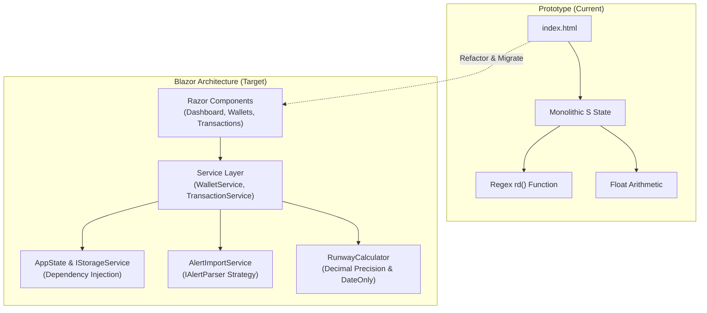

# One Wallet: Code Review & Prototype Evaluation

## Executive Summary

This document presents a comprehensive code review of the **One Wallet** application prototype (`index.html`) and evaluates its technical architecture against the target Blazor migration blueprint defined in [`docs/class-diagram.md`](file:///c:/Users/LOQ/Documents/2026-2027%20First%20Sem%20Files/AppDev/onewallet/docs/class-diagram.md).

The prototype implements a functional, single-page multi-wallet finance tracker with budget runway calculations, regex-based SMS alert parsing, reconciliation workflows, and responsive Tailwind CSS styling. While the prototype demonstrates high feature density and effective reactive mechanics in a compact footprint, the codebase exhibits critical technical debt, minified abstractions, and financial data integrity risks that must be resolved during the migration to Blazor and C#.

---

## 1. Prototype Architecture & Implementation Overview

| Module / Area | Prototype Implementation (`index.html`) | Evaluation | Target Blazor Counterpart |
|---|---|---|---|
| **State Management** | Global `S` object mutated directly and flushed via `R()` to `localStorage` | Functional prototype reactivity; lacks transactional rollback or change-tracking guards | `AppState` + `IStorageService` (`LocalStorageService`) |
| **Routing** | Hash-based routing (`window.onhashchange`) toggling `VW[view]()` functions | Lightweight SPA navigation supporting browser history | Blazor Page Directives (`@page "/dash"`, `@page "/wallets"`) |
| **Styling** | Tailwind CSS v4 via CLI compiler into `dist/output.css` using utility map `K` | Clean design system and responsive layout; dictionary lookup adds abstraction overhead | Scoped CSS / Tailwind utility classes directly in Razor markup |
| **Alert Parsing** | Single regex parser `rd()` with manual pattern heuristics for GCash, Maya, GoTyme | Working proof-of-concept; brittle to template changes or localized SMS variances | Strategy Pattern via `IAlertParser` implementations |
| **Financial Math** | Native JavaScript `Number` (IEEE 754 floating-point) | Prone to standard binary rounding errors on cents | System `decimal` (128-bit high-precision fixed-point) |

---

## 2. Key Findings & Detailed Analysis

### 2.1 Code Quality & Maintainability

#### Identified Issues:
- **Minified / Dense Naming Conventions**:
  The prototype relies heavily on terse single-letter identifiers (`S` for state, `R` for render, `E` for escape, `V` for DOM value getter, `K` for Tailwind class dictionary, `w` for wallets, `t` for transactions, `b` for bills, `tot`, `res`, `per`).
  ```javascript
  // Example from index.html (lines 5-6, 31-32)
  const TODAY='2026-09-30',PAYDAY='2026-10-15',$=n=>'₱'+Math.abs(n).toLocaleString('en-US',{maximumFractionDigits:2}),
  E=t=>String(t).replace(/[&<>"]/g,c=>({'&':'&amp;','<':'&lt;','>':'&gt;','"':'&quot;'}[c])),V=id=>document.getElementById(id).value;
  tot=()=>S.w.reduce((s,w)=>s+w.b,0),res=()=>S.b.reduce((s,b)=>s+b.a,0),
  days=()=>Math.round((new Date(PAYDAY)-new Date(TODAY))/864e5),per=()=>Math.max(0,(tot()-res())/days());
  ```
  *Impact*: Makes debugging, onboarding, and collaborative maintenance difficult. While concise for a quick prototype, production systems require self-documenting naming conventions.

- **Monolithic Component Structure**:
  All views (`login`, `dash`, `wal`, `tx`, `imp`, `bill`, `ins`, `set`, `help`) and modals (`tx`, `wal`, `bill`, `rec`) reside within a single `<script>` tag. View functions interpolate raw HTML strings into `innerHTML`.
  *Impact*: High coupling between view rendering, business rules, and DOM queries.

### 2.2 Financial Calculations & Data Integrity

#### Identified Issues:
- **Floating-Point Arithmetic Vulnerabilities**:
  Transaction amounts and balances use floating-point numbers:
  ```javascript
  function add(w, a, s, c) {
    S.t.unshift({ id: ++S.n, d: '09-30', s, c, w: +w, a });
    S.w.find(z => z.id == w).b += a;
  }
  ```
  *Impact*: In JavaScript, `0.1 + 0.2 === 0.30000000000000004`. Over numerous transactions, wallet reconciliations will introduce fractional cent drifting.
  *Remediation in Blazor*: C# `decimal` is specifically designed for financial calculations, eliminating floating-point rounding errors.

- **Hardcoded Temporal Settings**:
  `TODAY` ('2026-09-30') and `PAYDAY` ('2026-10-15') are fixed constants in lines 5 and 36, preventing dynamic dates or user-configured recurring pay frequencies (e.g., semi-monthly, weekly).
  *Remediation in Blazor*: Use `BudgetSettings` model with configurable `BudgetPeriod` and `DateOnly.FromDateTime(DateTime.Today)`.

### 2.3 Security & Input Sanitization

#### Positive Aspects:
- **Entity Escaping**: The `E()` function escapes HTML special characters (`&`, `<`, `>`, `"`) when outputting merchant names, wallet labels, and notes into DOM templates.

#### Identified Risks:
- **Inner HTML Injection Surface**:
  Dynamic template string concatenation into `innerHTML` remains vulnerable if any variable bypasses `E()`.
- **LocalStorage Data Exposure**:
  Financial transactions and balances are stored unencrypted in `localStorage` (`localStorage.setItem('onewallet', ...)`). For client-only prototypes this is standard, but sensitive user financial records should be handled with proper data protection when transitioning to production.

### 2.4 Alert Parsing Engine (`rd()`)

#### Identified Issues:
- The parser extracts amounts, transaction direction, merchants, and categories using sequential regex rules:
  ```javascript
  const inn=/received|credited|cash[- ]?in|deposit/i.test(x),
        out=/paid|sent|transferred|purchase|debited|cash[- ]?out/i.test(x),
        s=(x.match(/(?:to|from|at)\s+([A-Z][\w&' -]*?)(?:\.|,|\s+Ref|$)/)||[])[1]||'Unknown';
  ```
- *Brittle Heuristics*: A single SMS formatting update from providers (e.g. GCash omitting "to", or multi-currency symbols like `USD`) causes parsing failures or incorrect merchant extractions.
- *Remediation*: The Blazor class diagram introduces `IAlertParser` with dedicated parser classes (`GCashParser`, `MayaParser`, `GoTymeParser`) containing provider-specific regex definitions and unit test coverage.

### 2.5 User Experience & Accessibility (a11y)

- **Responsive Design**: The Tailwind grid (`flex-wrap [&>*]:flex-1 [&>*]:min-w-[220px]`) adapts effectively across desktop and mobile screens. Sidebar navigation correctly hides on small viewports (`max-md:hidden`).
- **Semantic HTML & Navigation**:
  - The navigation uses `<a>` tags with `onclick` handlers and without proper `href` attributes.
  - Buttons and interactive items lack ARIA attributes (`aria-expanded`, `aria-label`, `role="dialog"` for modals).
  - Modal focus trapping and keyboard navigation (e.g., closing via `Escape` key) are currently missing.

---

## 3. Prototype Strengths & Architectural Merits

Despite code density, the prototype demonstrates strong foundational design decisions:
1. **Unidirectional Reactive Loop**: Direct state-to-DOM synchronization pattern mimicking modern declarative frameworks.
2. **Reconciliation Pattern**: A practical design acknowledging that automated SMS alerts and manual tracking drift over time; the dedicated reconciliation adjustment ledger entry maintains auditability.
3. **Runway Metric**: Focuses on daily spendable budget until next payday rather than merely raw net worth, providing immediate actionable utility for users.
4. **Offline First**: Zero external runtime network dependency; instant loading and client-side persistence.

---

## 4. Recommendations for Blazor Implementation

Based on this review and [`docs/class-diagram.md`](file:///c:/Users/LOQ/Documents/2026-2027%20First%20Sem%20Files/AppDev/onewallet/docs/class-diagram.md), the following architectural refactorings should be applied during the Blazor build:



1. **Adopt C# `decimal` Across All Domain Models**:
   Ensure `Wallet.Balance`, `Transaction.Amount`, and `Bill.Amount` use `decimal` to prevent financial rounding discrepancies.
2. **Implement Strategy Pattern for SMS Import**:
   Implement `IAlertParser` with independent parsers (`GCashParser`, `MayaParser`, `GoTymeParser`) equipped with unit tests.
3. **Encapsulate State in `AppState` with Event-Driven Updates**:
   Replace direct state mutation with service methods that fire `OnChange` events to trigger Blazor `StateHasChanged()`.
4. **Standardize Semantic Razor Markup**:
   Use standard `<button>` and `<dialog>` elements or accessible modal overlays with keyboard support.
5. **Implement Unit Testing**:
   Add test coverage for `RunwayCalculator.Calculate()` and SMS parsers prior to UI implementation.

---

## 5. Conclusion

The prototype provides a proven, working baseline for the One Wallet user experience and business logic. The architecture defined in `docs/class-diagram.md` directly resolves the architectural shortcomings identified in this code review, preparing the application for a clean, robust, and scalable Blazor implementation.
